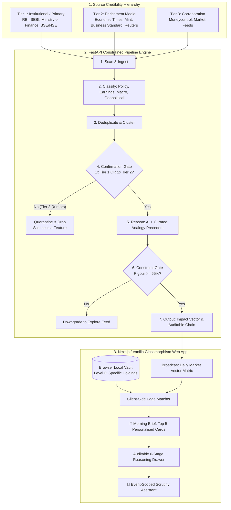

# Sarthi (सारथी)
### AI-Assisted Investment Decision Support System for Indian Retail Investors
*Version 2.0 · Institutional Noise-Cancellation & Behavioural Decision Engine*

[](https://python.org)
[](https://fastapi.tiangolo.com)
[](LICENSE)
[](https://www.sebi.gov.in)
[](#zero-knowledge-edge-personalisation)

---

## 🎯 Executive Overview

**99% of daily financial news is noise.** Traditional trading apps and financial media prioritize sensational headlines, high-frequency churn, and black-box price predictions to maximize brokerage fees and clicks.

**Sarthi** (*meaning guide or charioteer in Hindi*) inverts this model. It is an institutional-grade **noise-cancellation engine** designed to close the **rationality gap** that causes retail investors in India to panic-sell during structural market shifts.

### Core Philosophy
* **Conservative by Default**: Biased toward **No Action**. A signal requires rigorous source confirmation and a high confidence threshold. Staying quiet when evidence is weak is a feature, not a failure.
* **Reasoning-First Always**: Every output tells the user not just what to consider but *why* — with macroeconomic transmission channels, source clarity, and a fully auditable reasoning chain.
* **Human Authority**: Sarthi guides, it never decides. The system does not execute trades or issue illegal tips.
* **Anti-Hallucination Historical Grounding**: Standard LLMs hallucinate statistical claims (*"occurred in 4 of 5 past budgets"*). Sarthi bans numeric historical claims, anchoring reasoning to a curated dataset of **20 landmark Indian economic events** with mandatory **counter-analogy** checks.
* **Zero-Knowledge Edge Privacy**: Specific user holdings (Level 3) are stored and evaluated **exclusively inside the user's browser** via `localStorage`/`IndexedDB`. No personal equity portfolio balances ever touch our server.

---

## 🏛️ System Architecture



---

## ⚖️ SEBI Compliance Re-Engineering

Under **SEBI (Research Analysts) Regulations, 2014** and **SEBI (Investment Advisers) Regulations, 2020**, issuing direct transactional verdicts like `Buy/Add` or `Sell/Reduce` is legally classified as registered financial advisory.

Sarthi replaces speculative calls with **Structural Impact Vectors** and **Evidence Rigour Scores**:

| Legacy Concept | SEBI Regulatory Risk | Sarthi 2.0 Compliant Taxonomy | Analytical Meaning |
| :--- | :--- | :--- | :--- |
| `Buy / Add` | High (Unregistered Tip) | **`Thesis Tailwind / Growth Acceleration`** | Structural reform strengthens pricing power or TAM. |
| `Sell / Reduce` | High (Unregistered Tip) | **`Thesis Headwind / Margin Pressure`** | Regulatory or cost escalations alter unit economics. |
| `Hold / Monitor` | Medium (Transactional Hold) | **`Monitor Fundamental Variance`** | Event is unfolding; requires quarterly earnings confirmation. |
| `No Action` | Compliant | **`No Action / Transient Noise`** | Price reaction is transient; fundamentals unaltered. |
| `Confidence: 68%` | Medium (Misconstrued as price target) | **`Evidence Rigour: 68/100`** | Source tier credibility & historical analogy fit. |

---

## 🔒 Zero-Knowledge Edge Personalisation

```
                  ┌──────────────────────────────────────────────┐
                  │            SARTHI FASTAPI BACKEND            │
                  │   Computes daily macro/sector impact cards   │
                  │         Zero knowledge of user stocks        │
                  └──────────────────────┬───────────────────────┘
                                         │ Broadcasts daily event matrix
                                         ▼
                  ┌──────────────────────────────────────────────┐
                  │             USER BROWSER ENGINE              │
                  │   [IndexedDB / LocalStorage Vault]           │
                  │   - ITC: 20%                                 │
                  │   - HDFCBANK: 25%                            │
                  │   - TATAMOTORS: 15%                          │
                  │                                              │
                  │   Local Algorithm matches & scores cards:    │
                  │   Score = (HoldingWeight * 0.6) + (Rigour * 0.4) │
                  └──────────────────────┬───────────────────────┘
                                         ▼
                  ┌──────────────────────────────────────────────┐
                  │         TOP 5 PERSONALISED CARDS             │
                  │   Rendered instantly without network latency │
                  └──────────────────────────────────────────────┘
```

---

## 📚 Curated Landmark Precedents (Anti-Hallucination DB)

Sarthi seeds with **20 landmark Indian economic events**, ensuring every qualitative analogy is verifiable and includes mandatory counter-analogy guidelines:

* `IND_GST_2017`: Goods & Services Tax Rollout & Logistics Realignment (July 2017)
* `IND_DEMON_2016`: Demonetisation Cash Velocity Shock (Nov 2016)
* `IND_ILFS_2018`: IL&FS Default & Wholesale NBFC Liquidity Freeze (Sept 2018)
* `IND_COVID_2020`: COVID-19 Lockdown & Rapid Re-Rating Cycle (March 2020)
* `IND_CORP_TAX_2019`: Corporate Tax Rate Slash (30% to 22%) (Sept 2019)
* `IND_RBI_HIKE_2022`: Post-Pandemic RBI Rate Hike Cycle (4.00% to 6.50%) (2022-2023)
* `IND_TOBACCO_2020`: National Calamity Contingent Duty (NCCD) & Excise Hikes
* `IND_STEEL_DUTY_2022`: Export Duty Imposition on Primary Steel Products (May 2022)
* `IND_PLI_SCHEME_2020`: Production-Linked Incentive (PLI) Industrial Push (2020-2023)
* `IND_SEBI_T1_2023`: SEBI T+1 / Same-Day Rolling Settlement Migration (2023)
* `IND_RERA_2016`: Real Estate Regulatory Act (RERA) Industry Consolidation (2016)
* `IND_IBC_2016`: Insolvency and Bankruptcy Code (IBC) Cleansing Cycle (2016-2019)
* `IND_CRUDE_SHOCK_2022`: Russia-Ukraine Crude Oil Surge to $130/bbl (2022)
* `IND_TELECOM_AGR_2019`: Supreme Court AGR Verdict on Telecom Duopoly (2019)
* `IND_BANK_MERGER_2019`: Mega Consolidation of Public Sector Banks (10 into 4)
* `IND_WINDFALL_TAX_2022`: Windfall Profit Tax on Domestic Crude & Fuel Exports
* `IND_DEFENSE_INDIG_2021`: Defense Positive Indigenisation Lists & Domestic Capex Push
* `IND_SEMICON_PLI_2021`: India Semiconductor Mission ($10B Fiscal Outlay)
* `IND_RBI_UNSECURED_2023`: RBI Risk Weight Escalation on Consumer Credit (Nov 2023)
* `IND_LTCG_REINTRO_2018`: Reintroduction of 10% Long Term Capital Gains Tax (Feb 2018)

---

## 🧠 Kahneman-Thaler Behavioral Onboarding

Sarthi includes a progressive 7-screen behavioral onboarding flow:
1. **Identity & Age Band**: Low friction profile initialization.
2. **Income Stability**: Salaried vs. Business cash-flow cadence.
3. **Investment Horizon**: Time horizon buffer (5+ years vs. 2-5 years).
4. **Behavioral Loss-Aversion Simulation**: Puts the user in an authentic **₹10,00,000 $\rightarrow$ ₹7,80,000 (-22%)** rupee drop scenario to calculate their true loss-aversion coefficient ($\lambda$) and identify **Rationality Gaps**.
5. **Portfolio Disclosure Level**: Level 1 (Preferences), Level 2 (Rough Sectors), Level 3 (Zero-Knowledge In-Browser).
6. **Sector Avoidances**: Ethical, ESG, or religious exclusions (e.g. Tobacco, Gambling, Liquor).
7. **Calibrated Persona Summary**: Plain-English review of calibrated drawdown limits.

---

## 🚀 Quickstart Guide

### 1. Prerequisites
* Python 3.10+ (Tested on Python 3.13)
* Web browser (Chrome, Edge, Firefox, Safari)

### 2. Installation
```bash
# Clone the repository
git clone https://github.com/Manas-Jain-24/Sarthi.git
cd Sarthi

# Install dependencies
pip install -r requirements.txt
```

### 3. Run the Server
```bash
python scripts/run_server.py
```
Open **[http://localhost:8000](http://localhost:8000)** in your browser!

### 4. Run the Test Suite
```bash
python tests/run_tests.py
```
All 8 verification tests for the 7-step pipeline, confirmation gates, anti-hallucination rules, and behavioral profiler will execute:
```text
============================================================
SARTHI DECISION SUPPORT SYSTEM: TEST SUITE EXECUTION
============================================================
  [PASS] Step 1: Scanner & Source Hierarchy
  [PASS] Step 2: Event Classifier
  [PASS] Step 4: Confirmation Gate (Drop Tier 3 Rumors)
  [PASS] Step 5: Reasoner & Anti-Hallucination Grounding
  [PASS] Step 6: Constraint Gate (Forbidden Numeric Ban)
  [PASS] 7-Step End-to-End Pipeline Orchestration
  [PASS] Kahneman-Thaler Rationality Gap Detection
  [PASS] Consistent Behavioral Risk Calibration
------------------------------------------------------------
Results: 8/8 tests passed.
============================================================
ALL TESTS PASSED SUCCESSFULLY.
```

---

## 📡 REST API Reference

| Endpoint | Method | Description |
| :--- | :--- | :--- |
| `/api/v1/health` | `GET` | System health check and engine status. |
| `/api/v1/pipeline/run` | `GET` | Manually triggers the 7-step pipeline and returns telemetry. |
| `/api/v1/brief/daily` | `GET` | Broadcasts confirmed daily event cards for edge matching. |
| `/api/v1/brief/explore` | `GET` | Returns unpersonalized explore feed cards. |
| `/api/v1/events/{id}` | `GET` | Fetches full event with 6-stage auditable reasoning chain. |
| `/api/v1/analogies` | `GET` | Retrieves the 20 curated landmark Indian economic precedents. |
| `/api/v1/onboarding/calibrate` | `POST` | Calculates loss aversion index ($\lambda$) and calibrated risk. |
| `/api/v1/chat/event-assistant` | `POST` | Interrogates event card with context-bound analytical reasoning. |

---

## 📖 References & Academic Grounding

* **Kahneman, D.** (2011). *Thinking, Fast and Slow*. Farrar, Straus and Giroux.
* **Thaler, R. H., & Sunstein, C. R.** (2008). *Nudge: Improving Decisions About Health, Wealth, and Happiness*.
* **Kahneman, D., & Tversky, A.** (1979). Prospect Theory: An Analysis of Decision under Risk. *Econometrica*, 47(2), 263–291.
* **Rudin, C.** (2019). Stop explaining black box machine learning models for high stakes decisions. *Nature Machine Intelligence*, 1, 206–215.
* **Ji, Z., et al.** (2023). Survey of Hallucination in Natural Language Generation. *ACM Computing Surveys*, 55(12), 1–38.
* **Metzger, M. J., & Flanagin, A. J.** (2013). Credibility and trust of information in online environments. *Journal of Pragmatics*, 59, 210–220.

---

## 📄 License
This project is licensed under the MIT License — see the [LICENSE](LICENSE) file for details.
