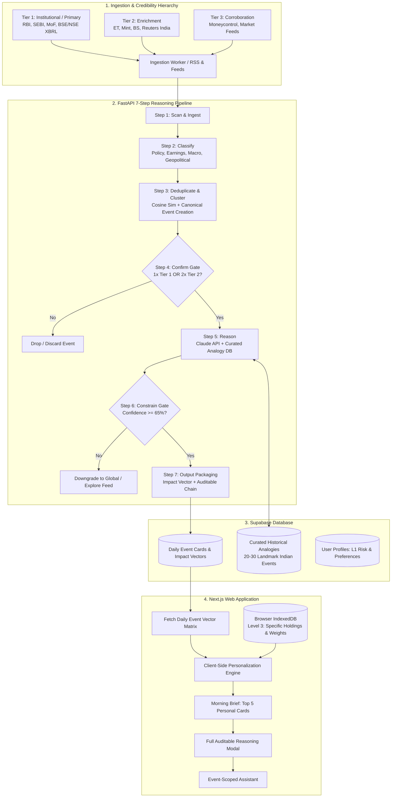
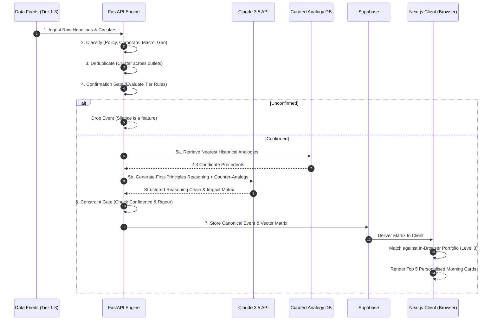
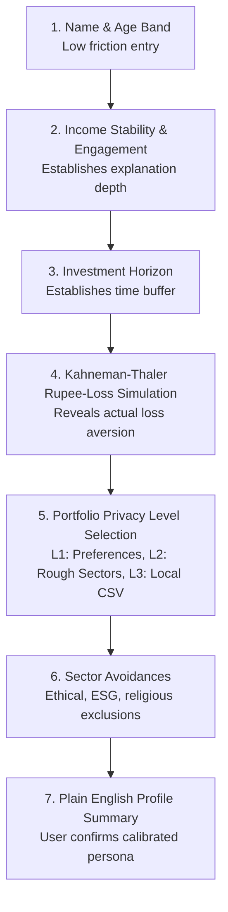
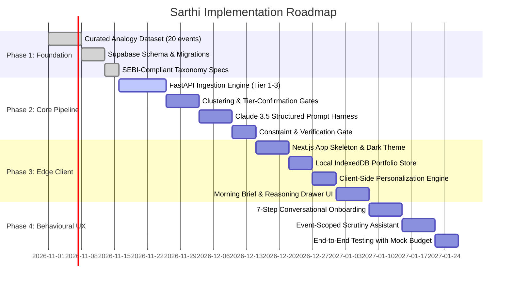

# Sarthi: Full Implementation Plan & Technical Architecture
**AI-Assisted Investment Decision Support System for Indian Retail Investors**
*Version 2.0 Architectural & Execution Blueprint*

---

## 1. Executive Summary & Core Design Principles

Sarthi is an AI-assisted decision support system engineered to bridge the **rationality gap** that leads retail investors in India to make emotionally charged, panic-driven investment decisions. It functions as an institutional-grade **noise-cancellation engine** rather than an engagement-driven news aggregator or a black-box algorithmic trading bot.

```
                  ┌──────────────────────────────────────────────┐
                  │                 RAW NOISE                    │
                  │   Financial media, sensational headlines,    │
                  │     rumors, panics, and opinion pieces       │
                  └──────────────────────┬───────────────────────┘
                                         ▼
                  ┌──────────────────────────────────────────────┐
                  │            7-STEP SARTHI PIPELINE            │
                  │  Tiered Credibility Gates + Constrained AI   │
                  │   + Curated Qualitative Historical Analogy   │
                  └──────────────────────┬───────────────────────┘
                                         ▼
                  ┌──────────────────────────────────────────────┐
                  │            CLIENT-SIDE EDGE FILTER           │
                  │  Matches against Level 3 Portfolio in-browser│
                  │        Zero server-side asset storage        │
                  └──────────────────────┬───────────────────────┘
                                         ▼
                  ┌──────────────────────────────────────────────┐
                  │            MORNING BRIEF (TOP 5)             │
                  │    Thesis Impact Vectors + Full Audit Chain  │
                  │         Default to "No Action / Calm"        │
                  └──────────────────────────────────────────────┘
```

### Core Architectural Pillars
1. **Conservative by Default**: Silence and "No Action" are intentional, successful outputs. An event is dropped if it fails institutional confirmation or confidence thresholds.
2. **SEBI Compliance by Design**: Replaces illegal unregistered transactional calls (`Buy`/`Sell`) with **Thesis Impact Vectors** and **Fundamental Factor Shifts**, insulating the platform legally under SEBI (Research Analysts) Regulations, 2014 and SEBI (Investment Advisers) Regulations, 2020.
3. **Anti-Hallucination Historical Analogies**: Prohibits LLM-generated statistical fabrications (*"occurred in 4 of 5 past budgets"*). Restricts historical comparisons to a curated, verifiable database of 20–30 structural Indian economic events with mandatory **Counter-Analogy** validation.
4. **Zero-Knowledge Portfolio Privacy (Edge Personalization)**: User portfolio holdings (Level 3) are held strictly in browser storage (`IndexedDB`) and evaluated locally against backend-broadcasted impact vectors. No personal portfolio balances or stock quantities ever touch the central database.
5. **Auditable Reasoning-First Model**: Every morning briefing card provides an auditable, six-part reasoning chain showing the source tier, transmission path, macro-to-micro reasoning, qualitative analogy, and explicit caveats.

---

## 2. High-Level System Architecture



---

## 3. SEBI Compliance & Output Taxonomy Refactor

To operate legally without requiring immediate SEBI Research Analyst (RA) or Registered Investment Advisor (RIA) registration, Sarthi strictly adheres to an analytical/decision-support paradigm rather than transactional recommendation.

### Taxonomy Transformation Table
| Original Concept | SEBI Regulatory Risk | Sarthi 2.0 Compliant Taxonomy | Meaning to User |
| :--- | :--- | :--- | :--- |
| `Buy / Add` | High (Deemed unregistered stock tip) | **`Thesis Tailwinds / Positive Exposure`** | Event reinforces structural sector growth or margin expansion. |
| `Sell / Reduce` | High (Deemed unregistered stock tip) | **`Thesis Headwinds / Margin Pressure`** | Event creates regulatory/cost headwinds; prompts thesis review. |
| `Hold / Monitor` | Medium (Transactional hold advice) | **`Monitor Fundamental Variance`** | Event is unfolding; key data points (e.g. quarterly commentary) needed. |
| `No Action` | Compliant (Preserved) | **`No Action / Noise Filtered`** | Market reaction is transient noise; fundamentals unchanged. |
| `Confidence: 68%` | Medium (Misconstrued as price probability) | **`Evidence Rigour: 68/100`** | Measure of source credibility and analogy fit, NOT price forecast. |

---

## 4. The 7-Step Pipeline Specification



### Step-by-Step Breakdown

#### Step 1: Scan (Credibility-Tiered Ingestion)
* **Tier 1 (Primary / Institutional)**: RBI Notifications RSS, SEBI Circulars RSS, PIB (Press Information Bureau) Cabinet releases, BSE/NSE Corporate Announcement API feeds.
* **Tier 2 (Enrichment)**: Economic Times, LiveMint, Business Standard, Reuters India.
* **Tier 3 (Corroborating)**: Moneycontrol, Financial Express, industry portals.

#### Step 2: Classify
* Fast classifier (rule-based NLP + lightweight model) assigns events into one of four buckets:
  1. `Policy/Regulatory`: Duty changes, tax reforms, monetary policy, SEBI rules.
  2. `Earnings/Corporate`: Mergers, Capex disclosures, demergers, leadership shifts.
  3. `Macro/Economic`: CPI inflation prints, IIP data, crude price spikes, current account deficit.
  4. `Geopolitical`: Trade sanctions, crude supply chokepoints, international conflict.

#### Step 3: Deduplicate & Cluster
* Sentence-transformer embeddings + MinHash clustering group reports covering the same core event.
* A single canonical event record is established with an incrementing `source_count` and recorded `source_tiers`.

#### Step 4: Confirm (Gate 1)
* **Rule**:
  * If $\ge 1$ Tier 1 source exists $\rightarrow$ **CONFIRMED IMMEDIATELY**.
  * If $\ge 2$ distinct Tier 2 sources corroborate $\rightarrow$ **CONFIRMED**.
  * If Tier 3 only $\rightarrow$ **HELD IN STAGING / DROPPED**. (Never surfaces alone).

#### Step 5: Reason (AI + Curated Dataset)
* **Curated Historical Precedent Retrieval**: Query the curated database of 20–30 historic Indian market shifts.
* **Prompt Contract**:
  * Must extract direct structural transmission mechanism (e.g. Tax $\uparrow \rightarrow$ Cost of Goods $\uparrow \rightarrow$ Volume vs Margin compression).
  * Must compare against the selected historical event.
  * **Mandatory Counter-Analogy**: Must explain why the current environment differs from the historical precedent (e.g., balance sheet health, product diversification).
  * **Numeric Ban**: Explicitly prohibited from fabricating historical market statistics.

#### Step 6: Constrain (Gate 2)
* Algorithmic verification layer checks:
  * Confidence score $\ge 65\%$.
  * Does the reasoning state logical contradictions?
  * If confidence $< 65\%$, downgrade from Morning Brief to Explore Feed or suppress entirely.

#### Step 7: Output Packaging
* Outputs packaged as structured JSON:
  * Canonical headline, Sector tags, Impacted Tickers list.
  * Structural Impact Vector (`Thesis Tailwind`, `Thesis Headwind`, `Monitor`, `No Action`).
  * Evidence Rigour Score ($0 - 100$).
  * Full 6-stage auditable reasoning chain + Caveat statement.

---

## 5. Curated Historical Analogy Dataset (Seed Events)

Sarthi seeds with 20 foundational Indian economic episodes, ensuring every AI analogy is verifiable and grounded:

| Event Code | Event Name | Period | Primary Impact Sectors | Structural Lesson Grounding |
| :--- | :--- | :--- | :--- | :--- |
| `IND_GST_2017` | GST Rollout & Realignment | July 2017 | FMCG, Logistics, Unorganized-to-Organized | Initial supply disruption followed by formal market share gains by organized leaders. |
| `IND_DEMON_2016` | Demonetisation Shock | Nov 2016 | Real Estate, NBFCs, Cash-heavy Retail | Short-term discretionary consumption shock; accelerated formal digital payments. |
| `IND_ILFS_2018` | IL&FS Default & NBFC Liquidity Crisis | Sept 2018 | NBFCs, Real Estate, Banking | Wholesale NBFC cost-of-borrowing surge; flight to quality towards AAA retail banks. |
| `IND_COVID_2020` | COVID-19 Lockdown & Stimulus | Mar 2020 | Discretionary, Tech, Pharma, Aviation | Massive transient drop followed by digital re-rating and rapid balance-sheet deleveraging. |
| `IND_CORP_TAX_2019`| Corporate Tax Rate Cut (30% to 22%) | Sept 2019 | Capital Goods, Manufacturing, BFSI | Free cash flow expansion; initiated Capex recovery in domestic manufacturing. |
| `IND_RBI_HIKE_2022`| RBI Post-Pandemic Rate Hike Cycle | May 2022 | Real Estate, Auto, Banking | NIM expansion for retail deposit-heavy banks; transient demand cooling for rate-sensitive loans. |
| `IND_TOBACCO_2020` | National Calamity Duty / Excise Hikes | Union Budgets | Tobacco, FMCG | Short-term margin compression; pricing power allows staggered pass-through over 2-3 quarters. |
| `IND_STEEL_DUTY_22`| Export Duty Imposition on Steel | May 2022 | Metals & Mining, Infrastructure | Immediate domestic price cooling; margin hit on export-oriented steel producers. |
| `IND_PLI_SCHEME`   | Production-Linked Incentive Rollout | 2020–2022 | Electronics, Pharma, Auto Components | Capex commitment required before margin accretion; benefits scaled domestic manufacturers. |
| `IND_SEBI_T1_2023` | SEBI T+1 & Instant Settlement Reform | 2023 | Brokerages, Depository, AMCs | Working capital efficiency; reduced systemic counterparty risk for market infrastructure. |

---

## 6. Database Schema (Supabase / PostgreSQL)

```sql
-- 1. Source Registry
CREATE TABLE sources (
    id UUID PRIMARY KEY DEFAULT gen_random_uuid(),
    name VARCHAR(100) NOT NULL,
    domain VARCHAR(255) NOT NULL,
    tier SMALLINT NOT NULL CHECK (tier IN (1, 2, 3)),
    feed_url TEXT,
    feed_type VARCHAR(50) DEFAULT 'rss', -- 'rss', 'api', 'scrape'
    is_active BOOLEAN DEFAULT TRUE,
    created_at TIMESTAMPTZ DEFAULT NOW()
);

-- 2. Raw Ingested Articles / Circulars
CREATE TABLE raw_events (
    id UUID PRIMARY KEY DEFAULT gen_random_uuid(),
    source_id UUID REFERENCES sources(id),
    title TEXT NOT NULL,
    url TEXT UNIQUE NOT NULL,
    raw_content TEXT,
    published_at TIMESTAMPTZ,
    ingested_at TIMESTAMPTZ DEFAULT NOW(),
    classification_category VARCHAR(50), -- 'policy', 'earnings', 'macro', 'geopolitical'
    is_processed BOOLEAN DEFAULT FALSE
);

-- 3. Clustered & Confirmed Canonical Events
CREATE TABLE canonical_events (
    id UUID PRIMARY KEY DEFAULT gen_random_uuid(),
    canonical_title TEXT NOT NULL,
    summary TEXT NOT NULL,
    category VARCHAR(50) NOT NULL,
    highest_tier SMALLINT NOT NULL,
    source_count INTEGER DEFAULT 1,
    is_confirmed BOOLEAN DEFAULT FALSE,
    confirmation_rule_met VARCHAR(100),
    first_detected_at TIMESTAMPTZ DEFAULT NOW(),
    confirmed_at TIMESTAMPTZ
);

-- 4. Curated Historical Analogy Dataset
CREATE TABLE curated_analogies (
    id UUID PRIMARY KEY DEFAULT gen_random_uuid(),
    code VARCHAR(50) UNIQUE NOT NULL,
    title VARCHAR(255) NOT NULL,
    period VARCHAR(100) NOT NULL,
    sectors_impacted TEXT[] NOT NULL,
    macro_context TEXT NOT NULL,
    transmission_mechanism TEXT NOT NULL,
    documented_outcome TEXT NOT NULL,
    typical_duration_months INTEGER,
    created_at TIMESTAMPTZ DEFAULT NOW()
);

-- 5. Reasoning Chains & Impact Vectors
CREATE TABLE event_reasoning_chains (
    id UUID PRIMARY KEY DEFAULT gen_random_uuid(),
    canonical_event_id UUID REFERENCES canonical_events(id) ON DELETE CASCADE,
    curated_analogy_id UUID REFERENCES curated_analogies(id),
    sectors TEXT[] NOT NULL,
    impacted_tickers TEXT[] NOT NULL,
    impact_vector VARCHAR(50) NOT NULL, -- 'thesis_tailwind', 'thesis_headwind', 'monitor', 'no_action'
    evidence_rigour_score SMALLINT NOT NULL CHECK (evidence_rigour_score BETWEEN 0 AND 100),
    why_it_matters TEXT NOT NULL,
    transmission_chain TEXT NOT NULL,
    historical_comparison TEXT NOT NULL,
    counter_analogy_differences TEXT NOT NULL,
    explicit_caveat TEXT NOT NULL,
    passes_constraint_gate BOOLEAN DEFAULT TRUE,
    created_at TIMESTAMPTZ DEFAULT NOW()
);

-- 6. User Profiles (Level 1 & 2 Preferences ONLY)
CREATE TABLE user_profiles (
    id UUID PRIMARY KEY REFERENCES auth.users(id) ON DELETE CASCADE,
    display_name VARCHAR(100),
    age_band VARCHAR(20),
    investment_horizon VARCHAR(50), -- 'long_term_5yr_plus', 'medium_term_2_5yr'
    stated_risk_tolerance VARCHAR(50), -- 'conservative', 'moderate', 'growth'
    revealed_loss_tolerance_pct NUMERIC(5,2), -- Derived from Rupee loss onboarding scenario
    disclosed_level SMALLINT DEFAULT 1 CHECK (disclosed_level IN (1, 2, 3)),
    rough_sector_allocations JSONB, -- For Level 2 users (e.g. {"BFSI": 40, "IT": 30})
    avoided_sectors TEXT[], -- Ethical/religious avoidances (e.g. ['tobacco', 'gambling', 'liquor'])
    updated_at TIMESTAMPTZ DEFAULT NOW()
);
```

> [!IMPORTANT]
> **Zero-Knowledge Guarantee**: Notice there is **NO table for user stocks or quantities**. Level 3 portfolios exist entirely inside the user's browser storage (`IndexedDB`). The server never knows which user owns which stocks.

---

## 7. Client-Side Edge Matching (Privacy-Preserving Engine)

```mermaid
flowchart LR
    subgraph Browser Storage
        IndexedDB[(Local IndexedDB\nPortfolio Tickers:\n- ITC (18%)\n- HDFCBANK (24%)\n- INFY (15%))]
    end

    subgraph Server Response
        API[GET /api/v1/brief/daily\nBroadcasts all daily reasoning cards\nwith impacted_tickers array]
    end

    subgraph Client-Side Matching Algorithm
        Matcher{Match Tickers & Sectors\nagainst Local IndexedDB}
        Ranker[Rank by: Portfolio Weight x Evidence Rigour]
        Filter[Apply Avoided Sector Filter]
    end

    API --> Matcher
    IndexedDB --> Matcher
    Matcher --> Filter
    Filter --> Ranker
    Ranker --> Top5[Render Top 5 Personalised Morning Cards]
```

### Algorithm
1. The client queries `GET /api/v1/brief/daily`. The response is a lightweight array of today's confirmed event cards (~5 to 12 cards), each containing `sectors`, `impacted_tickers`, `impact_vector`, and `evidence_rigour_score`.
2. The browser's local JavaScript runs a relevance scoring function:
   $$\text{Score} = (\text{HoldingWeight} \times 0.6) + (\text{EvidenceRigour} \times 0.4)$$
3. If an event matches an avoided sector from the user's settings, it is stripped of verdicts and moved to the Global Feed.
4. The top 5 scored cards populate the **Morning Brief**. All other cards remain accessible in the **Explore Feed**.

---

## 8. Onboarding Flow: Revealed Preference Calibration

Rather than standard superficial risk checkboxes, Sarthi uses a 7-step conversational onboarding process rooted in behavioral finance:



### Step 4 Calibration Scenario
* *Prompt*: *"Imagine your ₹10,00,000 investment drops to ₹7,80,000 (-22%) in 3 weeks due to global tariff tensions. What is your immediate instinct?"*
  1. **Sell everything to avoid further loss**: *Recalibrates risk tolerance to Ultra-Conservative (Loss aversion factor $\lambda = 2.5$).*
  2. **Do nothing; wait for recovery**: *Calibrates to Patient Long-Term ($\lambda = 1.6$).*
  3. **Deploy spare cash to buy the dip**: *Calibrates to Opportunistic Growth ($\lambda = 1.0$).*

---

## 9. Phased Execution Roadmap



### Phase Deliverables

#### Phase 1: Foundation & Curated Knowledge
* Populate `curated_analogies` with the 20 Indian market landmark events.
* Provision Supabase PostgreSQL instance and apply database migrations.
* Document strict SEBI-compliant output guidelines.

#### Phase 2: Ingestion & 7-Step Backend Pipeline (Python/FastAPI)
* Build asynchronous fetchers for BSE/NSE XBRL, PIB RSS, and SEBI feeds.
* Implement TF-IDF/Sentence-Transformer deduplication and the Tier Confirmation Gate.
* Implement Claude API integration with JSON Schema structured outputs (`why_it_matters`, `historical_analogy`, `counter_analogy_differences`, `impact_vector`, `evidence_rigour_score`, `explicit_caveat`).
* Unit-test the pipeline with synthetic events (e.g. tobacco excise hike, steel export duty, rate hike).

#### Phase 3: Edge Frontend (Next.js & IndexedDB)
* Create a modern, high-contrast dark-mode Next.js web application.
* Implement client-side `idb-keyval` or native `IndexedDB` manager for Level 3 CSV uploads.
* Build the client-side vector ranking engine that sorts the daily matrix against the user's holdings.
* Design the **Morning Brief Card** with tap-to-expand **Auditable Reasoning Drawer**.

#### Phase 4: Behavioural Calibration & Interactive Assistants
* Build the 7-step progressive onboarding wizard with Kahneman-Thaler loss scenarios.
* Implement the context-isolated **Event Assistant** (scoped strictly to the selected event card to avoid general chat drift).
* Conduct end-to-end integration testing and benchmark against historical market events.

---

## 10. Key Verification & Success Metrics

1. **Noise-Reduction Ratio**: At least $85\%$ of raw incoming news items must be discarded by Steps 3 & 4 (Deduplication and Tier Confirmation).
2. **Zero Quantitative Hallucinations**: 100% adherence to qualitative analogies; automated unit tests fail if numerical claims (e.g., "$X\%$ return in $Y$ months") are generated.
3. **Client Privacy Guarantee**: Zero network requests from the client contain holding stock names or quantities. All matching happens client-side in $< 50\text{ms}$.
4. **Audit Trail Completeness**: 100% of morning brief cards contain all 6 required fields: source verification, transmission mechanism, historical comparison, counter-analogy, impact vector, and explicit caveat.
